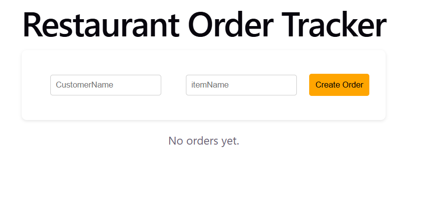

# 🍽️ Restaurant Order Tracking App

A full-stack Restaurant Order Tracking application designed to manage restaurant orders through a separate frontend and backend architecture.

The application follows a modular structure with dedicated folders for frontend components, backend controllers, database models, routes, and configuration.

## 🌐 Live Demo

[View Live Application](https://restrautant-order-tracking-app.vercel.app/)

## ✨ Features

- Restaurant order management.
- Order tracking functionality.
- User-friendly application interface.
- Separate frontend and backend architecture.
- Modular backend structure using controllers, models, and routes.

_Update this list with the exact features implemented in your application._

## 🛠️ Technologies Used

**Frontend**

- React.js
- JavaScript
- Vite
- CSS

**Backend**

- Node.js
- Express.js (if used in your server)

**Database**

- Add your actual database technology here.

**Tools**

- Git and GitHub
- VS Code
- Vercel

## 📂 Project Structure

```text
RestaurantOrderTrackingApp/
│
├── client/
│   └── OrderTracking/
│       ├── public/
│       ├── src/
│       ├── package.json
│       └── vite.config.js
│
├── server/
│   ├── config/
│   ├── controllers/
│   ├── model/
│   ├── routes/
│   ├── .env
│   ├── package.json
│   └── server.js
│
└── README.md
```

## ⚙️ Installation and Setup

### 1. Clone the repository

```bash
git clone YOUR_GITHUB_REPOSITORY_URL
```

### 2. Setup Frontend

Navigate to the frontend directory:

```bash
cd RestaurantOrderTrackingApp/client/OrderTracking
```

Install dependencies:

```bash
npm install
```

Start the development server:

```bash
npm run dev
```

Frontend runs at:

```text
http://localhost:5173/
```

### 3. Setup Backend

Open another terminal and navigate to the server directory:

```bash
cd RestaurantOrderTrackingApp/server
```

Install dependencies:

```bash
npm install
```

Configure your environment variables in a `.env` file.

Start the backend:

```bash
node server.js
```

## 🔐 Environment Variables

Create a `.env` file inside the server directory.

Add the environment variables required by your application.

Example:

```env
PORT=5000
MONGODB_URI=your_database_connection_string
```

Do not upload your actual `.env` file or database credentials to GitHub.

## 📸 Screenshots

Add screenshots of your application here.

```markdown

```

## 📚 Key Learning Outcomes

- Understanding full-stack application architecture.
- Separating frontend and backend responsibilities.
- Organizing backend code using controllers, models, and routes.
- Building and integrating frontend and backend functionality.
- Managing environment variables.
- Deploying frontend applications using Vercel.
